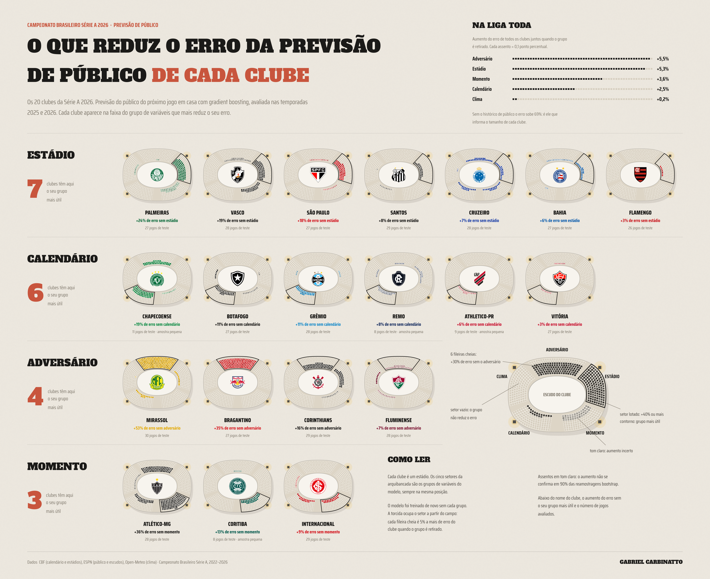

# Previsão de Público no Brasileirão

## Resumo

Prevê o público do próximo jogo em casa de cada clube da Série A depois da pandemia (2022 a 2026) e mede, clube a clube, que tipo de informação melhora a previsão:

- **Dados.** Calendário oficial da CBF (data, horário e estádio de cada partida desde 2020), público de cada jogo publicado pela ESPN desde 2022 e clima hora a hora da cidade-sede pelo Open-Meteo.
- **Variáveis.** Seis grupos calculados apenas com informação anterior ao jogo: histórico de público, calendário (dia da semana, horário, feriado), clima (temperatura, chuva), momento esportivo (Elo, últimos cinco jogos, posição na tabela), adversário (força, poder de atrair público, clássico) e estádio (troca de estádio, capacidade relativa).
- **Modelos.** Quatro previsões feitas só com a série de público (último jogo, média móvel, suavização exponencial e mediana do clube), uma regressão com defasagens e um gradient boosting, avaliados em janela expansiva: ajuste em 2024 e teste em 2025 e 2026. O gradient boosting erra 6,3 mil torcedores por jogo, 13% menos que a melhor previsão feita só com a série e 17% menos que a média móvel, e supera a média móvel em 21 de 24 clubes. Cada previsão vem com um intervalo conformal de 80%.
- **O que ajuda cada clube.** Cada grupo é retirado do modelo por vez, e o aumento do erro de cada clube é medido com bootstrap pareado. No conjunto da liga, adversário (+5,5%) e estádio (+5,3%) são os grupos mais úteis, seguidos de momento e calendário; o clima não altera o erro. Por clube, os perfis variam: o estádio é o grupo mais útil para Palmeiras, Vasco e São Paulo, o adversário para Mirassol, Bragantino e Corinthians, o calendário para Chapecoense, Botafogo e Grêmio, e o momento para Atlético-MG e Internacional.
- **Limitações.** A ESPN deixou de publicar o público da Série A no fim de maio de 2026, então a temporada de teste de 2026 tem 177 jogos. A carga de ingressos e os preços não estão em nenhuma fonte pública sistemática: o boletim financeiro da CBF é uma imagem escaneada e registra os ingressos vendidos, não a carga oferecida.

## Estrutura

- `notebooks/00-data_collection.ipynb`: coleta o calendário da CBF, o público da ESPN, as coordenadas das cidades-sede e o clima por hora.
- `notebooks/01-data_clean.ipynb`: associa os clubes entre as fontes, une o público ao calendário e marca jogos sem público ou com restrição.
- `notebooks/02-feature_engineering.ipynb`: calcula Elo, momento, tabela, histórico de público, calendário, clima, adversário e estádio.
- `notebooks/03-exploratory_analysis.ipynb`: nível dos clubes, público relativo por condição e público por estádio.
- `notebooks/04-forecasting_models.ipynb`: previsões só com a série, regressão com defasagens e gradient boosting, com intervalos conformais.
- `notebooks/05-feature_group_ablation.ipynb`: ablação por grupo de variáveis e contribuições SHAP por clube.
- `notebooks/06-results.ipynb`: figuras e discussão dos resultados.
- `notebooks/07-poster.ipynb`: pôster com as arquibancadas dos 20 clubes da Série A 2026.
- `data/raw/`: respostas originais da CBF, da ESPN e do Open-Meteo, e escudos dos clubes.
- `data/interim/`: tabelas coletadas de cada fonte.
- `data/processed/`: tabela de partidas, variáveis, previsões e resultados da ablação.
- `assets/fonts/`: Alfa Slab One e Saira Condensed, sob a licença SIL Open Font License.
- `viz/`: figuras dos resultados e o pôster.

## Saídas

| arquivo ou pasta | conteúdo |
|---|---|
| `data/processed/matches.csv` | uma linha por partida da Série A de 2020 a 2026, com horário, estádio, placar, público e situação do público |
| `data/processed/features.csv` | uma linha por jogo em casa depois da pandemia, com todas as variáveis |
| `data/processed/feature_groups.json` | as colunas de cada grupo de variáveis |
| `data/processed/exploratory/` | nível dos clubes, público relativo por condição e público por estádio |
| `data/processed/forecasting/` | previsões e intervalos por jogo de teste, erro por modelo, temporada e clube |
| `data/processed/ablation/` | aumento do erro por clube e grupo, proporções bootstrap e efeitos SHAP |
| `viz/6_*.png` | as oito figuras dos resultados |
| `viz/7_01_arquibancadas_serie_a_2026.png` | pôster com os 20 clubes da Série A 2026 |
